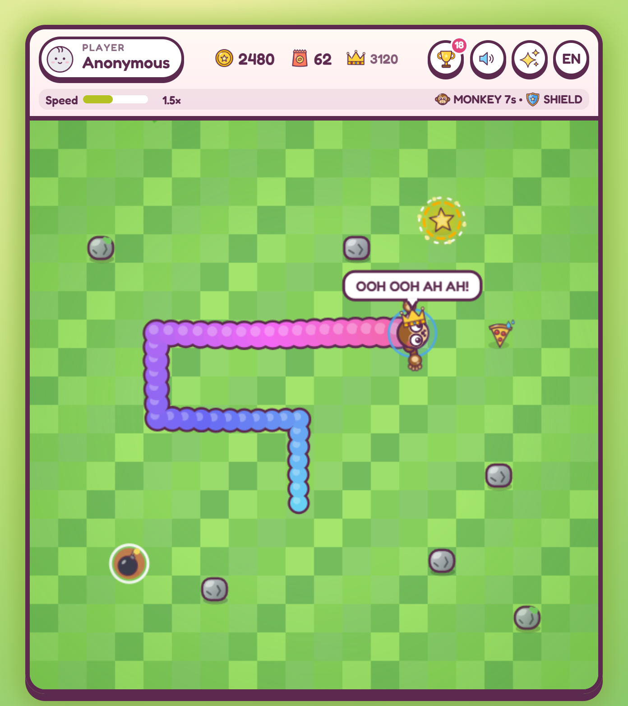

# Sir Noodle's Snack Quest

Snake, but snackier. Guide Sir Noodle across the grass, eat everything, grow a fancy hat, and don't bonk
into the rocks falling from the sky.

**[▶ Play it in your browser](https://sansui233.github.io/static/sir-noodle/)** (desktop and phone, English / 简体中文)

## How to play

| Keyboard | Touch | |
|---|---|---|
| Arrows / WASD | swipe (one drag can chain turns) | move |
| Space / P / Esc | tap | pause, resume |
| Space / Enter | tap | start, replay |
| T | 🏆 button | records and achievements |
| M / L | buttons | mute / low effects for slower devices |

Snacks give points and speed you up; the edges of the board wrap around. Every 5th snack Sir Noodle burps up
a better hat, all the way to the crown.
After 50 points rocks start falling: watch for the red warning, then steer around them. Biting your own tail
or hitting a rock ends the run.

## Power-ups

| Pickup | Effect |
|---|---|
|  Chili | Spicy: faster, double points |
|  Ice | Chill: slow motion |
|  Mushroom | Dizzy: controls flipped, triple points |
|  Star | God Mode: smash through rocks and yourself, double points |
|  Banana | Monkey Mode: paws grab snacks and fling rocks away |
|  Moon | Night: a sleepy slow-down, wake up at starting speed |
|  Shield | blocks one rock hit (stacks to 3) |
|  Bomb | zaps the nearest rock |
|  Super bomb | clears every rock on the board |

Effects stack, and so do their multipliers.

## Also inside

- **34 achievements** in four rarities, from *First Bite* to *Hall of Fame*
- **Your top 10 runs** with a podium, plus a name and one of 13 avatars
- **English and 简体中文**, picked from your browser, switch any time
- Everything is saved in your browser; nothing is sent anywhere

## Play offline

Download this repository (or a release zip) and open `index.html`. No install, no server, no internet needed.

---

Made with plain JavaScript and canvas, no dependencies. Notes for developers: [docs/development.md](docs/development.md).
Font: [Fredoka](assets/fonts/OFL.txt) (SIL Open Font License).
